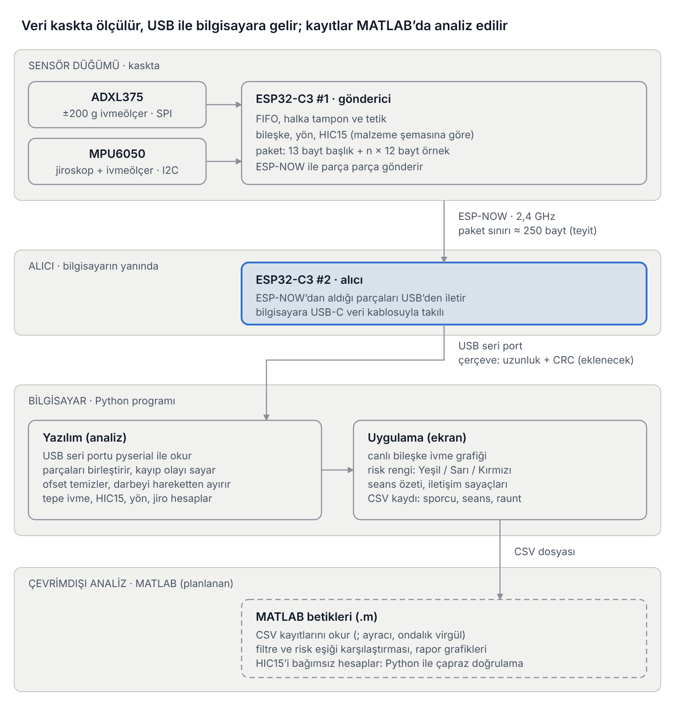
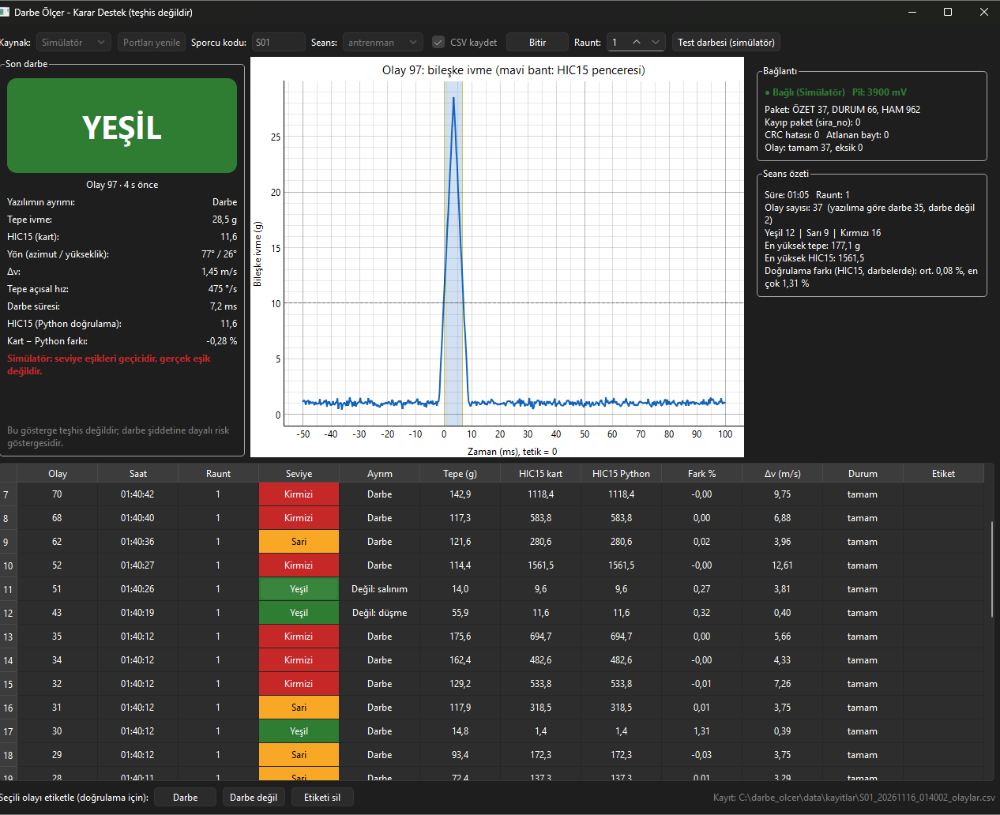

# Dövüş Sporları İçin Giyilebilir Darbe Ölçer — Sinyal İşleme ve Karar Destek Alt Sistemi

> **Bu bir teşhis aracı değildir.** Sistem, kaska gelen darbenin ölçülen şiddetine dayalı bir
> **risk göstergesi** üretir. Beyin sarsıntısı tanısı koymaz.

## Konu

Boks kaskındaki sensör kartından gelen darbe olaylarını okuyup gerçek darbeyi diğer
hareketlerden ayıran, darbenin şiddetini, yönünü ve HIC15 değerini hesaplayarak sağlık ekibine
Yeşil/Sarı/Kırmızı risk uyarısı veren sinyal işleme ve karar destek yazılımı.

## Sistem şeması



Kasktaki kart (ESP32-C3 #1) bileşke ivme 10 g'yi aşınca **yalnız o olayı** gönderir: kendi
hesapladığı **özet** (tepe ivme, HIC15, yön, seviye) ve olay penceresinin **ham örnekleri**.
Alıcı kart (ESP32-C3 #2) bunları USB seri port üzerinden bilgisayara iletir; bu depodaki
yazılım o noktadan sonrasını yapar.

## Uygulama



Simülatörle çalışan bir seanstan görüntü: solda kartın gönderdiği risk seviyesi ve son darbenin
değerleri (altında Python'un bağımsız doğrulaması), ortada son darbenin bileşke ivmesi (mavi
bant: HIC15 penceresi), sağda bağlantı, iletişim sayaçları ve seans özeti, altta darbe listesi.
Başlatmak için: `python calistir.py`.

## Kapsam

### Kapsam içi — benim alt sistemim (bu depo)

| İş | Durum |
|---|---|
| USB seri porttan paketleri okuma, olayları birleştirme, kayıp/CRC sayaçları (sözleşmenin tüketici tarafı) | yapıldı |
| Simülatör: gerçek kartla aynı baytları üreten sahte veri kaynağı | yapıldı |
| Tepe ivme, yön, Δv, darbe süresi ve HIC15'in ham veriden **bağımsız** hesabı; kartın sonucuyla karşılaştırma | yapıldı |
| Örnekleme hızı ve sensör kırpılmasının HIC15'e etkisinin analizi | yapıldı |
| Uyarı arayüzü: Yeşil/Sarı/Kırmızı gösterge, son darbe grafiği, seans özeti, etiketleme, CSV kaydı | yapıldı |
| Simülatörde darbe olmayan olaylar ve 20 örneklik etiketli test kümesi | yapıldı |
| Ham verinin filtrelenmesi (sıfır fazlı alçak geçiren; kesme frekansı seçimi MATLAB'da) | ilk sürüm |
| **Darbe / darbe değil ayrımı** (kart ayrım yapmıyor; eşiği aşan her olayı gönderiyor) | ilk sürüm, yalnız simülatörde sınandı |
| MATLAB: çevrimdışı analiz, filtre/eşik karşılaştırması, HIC15 çapraz doğrulaması | planlandı |

### Kapsam dışı — arkadaşımın alt sistemi (donanım ve gömülü yazılım)

- Sensörler (ADXL375, MPU6050), okunmaları ve kalibrasyonu
- Tetik, olay penceresi ve kartın kendi hesapları (tepe, HIC15, Δv, seviye)
- ESP-NOW iletimi, alıcı kart ve USB çerçevesinin üretilmesi
- Pil, kutu ve kaska montaj

Bu depo arkadaşımın kodunu içermez; iki alt sistem yalnızca aşağıdaki
*Arayüz sözleşmesi* üzerinden birleşir.

### Kimsenin kapsamında olmayan

- Tıbbi teşhis. Sistem beyin sarsıntısı tanısı koymaz; darbe şiddetine dayalı risk göstergesidir.

## Başarı ölçütleri

Hedef değerler danışmanla belirlenecek (`___`).

| Ölçüt | Nasıl ölçülür | Hedef |
|---|---|---|
| **Darbe tespit duyarlılığı** | Etiketli test kümesinde (bkz. *Etiketli test kümesi*) "darbe" etiketli olayların yazılım tarafından darbe olarak sınıflandırılma oranı: DP / (DP + YN) | en az % ___ |
| **Yanlış alarm oranı** | Aynı kümede "darbe değil" etiketli olayların yanlışlıkla darbe sayılma oranı: YP / (YP + DN) | en çok % ___ |
| **Uyarı gecikmesi** | Olayın son paketinin bilgisayara ulaştığı an ile risk renginin ekranda güncellendiği an arasındaki süre; kod içi zaman damgasıyla, en az ___ olay üzerinden ortanca ve en kötü değer | en çok ___ ms |

DP: doğru pozitif, YN: yanlış negatif, YP: yanlış pozitif, DN: doğru negatif.
Kaskta darbenin olduğu an ile ekran arasındaki **uçtan uca** gecikme, arkadaşımın ölçeceği
kablosuz iletim süresiyle birlikte raporlanır.

### Ek doğrulama ölçütleri

| Ölçüt | Nasıl ölçülür | Hedef |
|---|---|---|
| Bağımsız hesabın doğruluğu | Sonucu elle hesaplanabilen sentetik darbelerde (dikdörtgen, yarım sinüs, üçgen) HIC15'in analitik değerden farkı (`tests/test_hesap.py`) | en çok % ___ |
| Python–MATLAB uyumu | Aynı CSV kayıtlarında iki bağımsız uygulamanın HIC15 ve tepe ivme farkı | en çok % ___ |
| Kart–bilgisayar uyumu | Kartın HIC15/tepe sonucu ile bağımsız hesap arasındaki fark; nedeni açıklanır | en çok % ___ |
| İletişim güvenilirliği | Seans boyunca eksik olay oranı (sayaçlar arayüzde ve `_seans.csv`'de) | en çok % ___ |

### Bilinen sınırlamalar

- HIC15 tek başına sarsıntıyı öngörmek için yeterli bir ölçüt değildir; dönme hareketini
  (açısal ivme/hız) hesaba katmaz. Boksa özel, doğrulanmış tek bir HIC eşiği yoktur. Risk
  eşikleri bu yüzden kodda sabit değildir; ayar dosyasından okunur ve kaynağıyla birlikte
  raporda gerekçelendirilir.
- Kaskın ölçtüğü ivme, kafanın kendi ivmesiyle aynı değildir (kask ile kafa arasında
  boşluk/köpük vardır).
- Δv hesabında darbe sırasında yerçekimi düzeltilmez (≈ g × darbe süresi kadar hata; 10 ms'de ≈ 0,1 m/s).
- ADXL375 duyarlılık toleransı ≈ ±%10 (veri sayfası); kalibrasyon bu hatayı azaltır ama sıfırlamaz.
  Ofset sıcaklıkla ≈ ±10 mg/°C kayar; sabit kalibrasyon bu kaymayı izlemez.
- Jiro değeri ADXL375 hızında değil, MPU6050'nin I2C okuma hızında yenilenir.
- Referans ölçüm cihazı yoktur; doğrulama sentetik darbeler, bağımsız iki uygulama (Python ve
  MATLAB) ve etiketli kayıtlarla yapılır.

---

## Arayüz sözleşmesi (protokol sürümü 1 — ortak)

> Bu bölüm donanım ekibiyle **ortak** sözleşmedir; iki taraf da bayt bayt buna uyar.
> ÖZET (0x01) ve DURUM (0x02): donanım ekibinin README'si "5. Kablosuz paket sözleşmesi".
> HAM (0x03) ve USB çerçevesi: yazılım ekibinin önerisi, donanım ekibi kabul etti.
> Karar geçmişi ve açık sorular: [docs/donanim_kararlari.md](docs/donanim_kararlari.md).
> Çalışan hali: `src/darbe/protokol.py`, testleri: `tests/test_protokol.py`. `___` = henüz belirlenmedi.

### Genel kurallar

- Bayt sırası **little-endian**; yapılar `__attribute__((packed))`, dolgu baytı yok.
- **Her paketin 1. baytı `protokol_surumu`, 2. baytı `paket_tipi`.**
- **Sürüm kuralı:** yeni alan gerekirse paketin **sonuna** eklenir ve `protokol_surumu` artar.
  Bilgisayar, tanıdığından yeni sürümdeki paketin bildiği kısmını okur, fazlasını saklar.
- Tüm ölçekler tasarım tercihidir, ölçüm sonucu değildir.
- Kart **yalnız tetiklendiğinde** olay gönderir (1 ÖZET + 26 HAM parça). Arada periyodik DURUM
  gönderir (**1 s**). Kart "hareket" sınıflandırması yapmaz.
- `zaman_damgasi_us`: vericinin açılıştan beri saydığı µs; 2³² µs ≈ 71,6 dakikada sıfıra döner.
  Bilgisayar, ardışık paketlerde zamanın geri gittiğini görünce bunu düzeltir (taşma telafisi).
  Olaylar zamanla değil `sira_no`/`olay_no` ile eşleştirilir.

| `paket_tipi` | Paket | Boyut |
|---|---|---|
| 0x01 | Darbe olayı (ÖZET) | 29 bayt |
| 0x02 | Durum (periyodik) | 12 bayt |
| 0x03 | HAM parça | 13 + n × 12 bayt (n ≤ 19) |

### Sürüm 1 için sabitler (pakette gönderilmez; değişirse sürüm artar)

| Parametre | Değer | Not |
|---|---|---|
| ADXL375 | ±200 g, SPI, **3200 Hz** | HAM'de ham LSB, **kalibrasyon uygulanmaz** |
| ADXL375 kalibrasyonu | eksen başına ofset ve duyarlılık: ___ | **sabit kalibrasyon**: her sensör 6 yönlü kalibrasyonla bir kez ölçülür, değerler kartın koduna ve buraya yazılır; açılışta ofset ölçümü yapılmaz. Tipik 0,049 g/LSB (≈ 20,4 LSB/g; veri sayfası 18,4–22,6 LSB/g) |
| MPU6050 jiro | ±2000 °/s, 1/16,4 °/s/LSB, I2C | ADXL ile senkron değil; her örneğe **son okunan jiro değeri** konur, ardışık örneklerde tekrar eder |
| Olay penceresi | tetikten önce **160** + sonra **320** = **480 örnek** (50 + 100 ms) | 26 HAM parça |
| Tetik | bileşke ≥ **10 g** (doğrulanmalı), ofset düzeltilmiş, yerçekimi dahil | test modu eşiği: ___ g |
| Aynı pencerede ikinci darbe | tetikten sonraki 100 ms içindeki ikinci aşım aynı olaya dahil | |
| Eksen takımı | sensör ekseni (kartın üstünde basılı); kafaya göre yönü ___ | montajdan sonra |

### Katman 1 — USB çerçevesi (alıcı kart → bilgisayar)

| Bayt | Alan | Tür | Açıklama |
|---|---|---|---|
| 0–1 | `sync` | 2 × uint8 | `0xAA 0x55` |
| 2–3 | `uzunluk` | uint16 | yük uzunluğu (bayt), 1…250 |
| 4… | `yuk` | bayt dizisi | ESP-NOW'dan gelen paket, **değiştirilmeden** |
| son 2 | `crc` | uint16 | CRC-16/CCITT-FALSE (poly 0x1021, başlangıç 0xFFFF), `uzunluk` + `yuk` üzerinden |

- CRC kontrol değeri: `"123456789"` → `0x29B1`.
- ESP32-C3 yerleşik USB (CDC); baud fiilen önemsiz, 115200. COM numarası bilgisayara göre değişir.
- Alıcının açılışta bastığı metin satırları (___ satır) ayrıştırıcı tarafından atlanır ve sayılır.

### 0x01 Darbe olayı (ÖZET) — 29 bayt

| Alan | Bayt | Tür | Birim | Açıklama |
|---|---|---|---|---|
| `protokol_surumu` | 1 | uint8 | — | ilk sürüm: 1 |
| `paket_tipi` | 1 | uint8 | — | 0x01 |
| `cihaz_id` | 1 | uint8 | — | sensör düğümü numarası |
| `sira_no` | 2 | uint16 | — | her ÖZET/DURUM paketinde 1 artar (ortak sayaç; HAM artırmaz); HAM'deki `olay_no` ile aynı değer. Ardışık olayların numaraları arasında atlama normaldir (aradaki DURUM'lar) |
| `zaman_damgasi_us` | 4 | uint32 | µs | tetik anı (eşiğin ilk aşıldığı örnek) |
| `tepe_ivme_bilesik` | 2 | uint16 | 0,01 g | √(x²+y²+z²) tepe değeri, ADXL375 |
| `tepe_ivme_x`, `_y`, `_z` | 3 × 2 | int16 | 0,01 g | tepe anındaki eksen değerleri |
| `tepe_acisal_hiz` | 2 | uint16 | 0,1 °/s | bileşke açısal hız tepe değeri, MPU6050 |
| `darbe_suresi_us` | 2 | uint16 | µs | bileşkenin eşik üstünde kaldığı süre |
| `delta_v` | 2 | uint16 | mm/s | darbe sırasındaki hız değişimi (tanım aşağıda) |
| `hic15` | 2 | uint16 | 0,1 | HIC15 × 10 (ör. 425 → 42,5; üst sınır 6553,5) |
| `seviye` | 1 | uint8 | — | 0 Yeşil, 1 Sarı, 2 Kırmızı. Eşikler: ___ |
| `bayraklar` | 1 | uint8 | bit | bit0 ADXL375 doydu, bit1 MPU6050 doydu, bit2 düşük pil, bit3 tampon taştı, bit4–7 ayrılmış |
| `pil_mv` | 2 | uint16 | mV | pil gerilimi |

ADXL375 doyduysa (bit0) tepe değer ve HIC15 gerçek değerin altında kalır; bu olaylar **en az
Sarı** gösterilir. Azimut/yükseklik açısını bilgisayar tepe vektöründen hesaplar:
`azimut = atan2(y, x)`, `yukseklik = atan2(z, √(x² + y²))` (sensör ekseninde).

### 0x02 Durum (periyodik) — 12 bayt

| Alan | Bayt | Tür | Birim | Açıklama |
|---|---|---|---|---|
| `protokol_surumu` | 1 | uint8 | — | 1 |
| `paket_tipi` | 1 | uint8 | — | 0x02 |
| `cihaz_id` | 1 | uint8 | — | |
| `sira_no` | 2 | uint16 | — | olay paketleriyle aynı sayaç |
| `zaman_damgasi_us` | 4 | uint32 | µs | gönderim anı |
| `pil_mv` | 2 | uint16 | mV | |
| `bayraklar` | 1 | uint8 | bit | olay paketiyle aynı tanım |

### 0x03 HAM parça — 13 bayt başlık + n × 12 bayt örnek

| Alan | Bayt | Tür | Birim | Açıklama |
|---|---|---|---|---|
| `protokol_surumu` | 1 | uint8 | — | 1 |
| `paket_tipi` | 1 | uint8 | — | 0x03 |
| `olay_no` | 2 | uint16 | — | ait olduğu ÖZET'in `sira_no`'su |
| `parca_no` | 1 | uint8 | — | 0'dan başlar |
| `parca_toplam` | 1 | uint8 | adet | 26 |
| `ilk_ornek_no` | 2 | uint16 | — | bu parçadaki ilk örneğin olay içindeki sırası (0…479) |
| `n` | 1 | uint8 | adet | bu parçadaki örnek sayısı (1…19) |
| `tetik_zamani_us` | 4 | uint32 | µs | ÖZET'teki `zaman_damgasi_us` ile **birebir aynı** değer |
| **her örnek:** `ax, ay, az` | 3 × 2 | int16 | LSB | ADXL375 ham (kalibre edilmemiş) |
| **her örnek:** `gx, gy, gz` | 3 × 2 | int16 | LSB | MPU6050 jiro, tutulmuş son değer |

19 örnek ile 13 + 19 × 12 = 241 bayt (≤ 250). Örnek zamanı:
`t_ms = (ornek_no − 160) / 3200 × 1000` (tetik anı = 0).

### Olay birleştirme (bilgisayar tarafı)

- ÖZET ve aynı numaralı tüm HAM parçaları gelince olay **tamam** sayılır; geliş sırası önemsiz.
- 1 s içinde (varsayım) tamamlanmayan olay **eksik** işaretlenir. Eksik olayda bağımsız doğrulama
  yapılmaz; ÖZET geldiyse kartın sonucu "doğrulanmamış" etiketiyle gösterilir.
- ÖZET ve DURUM'un ortak `sira_no` sayacındaki boşluklar **kayıp paket** olarak sayılır
  (16 bit taşma ve kart yeniden başlaması kayıp sayılmaz).

### Hesap yöntemi (kart ve bilgisayar aynı tanımı kullanır)

| Büyüklük | Tanım |
|---|---|
| Bileşke ivme | `√(ax² + ay² + az²)`, kalibre, g, **yerçekimi çıkarılmaz** |
| Tepe ivme | olay penceresindeki en büyük bileşke |
| HIC15 | bileşke ivmeden (g), t₂ − t₁ ≤ 15 ms olan tüm aralıklarda `(t₂−t₁)·[ort. ivme]^2,5` değerinin en büyüğü, her örnek adımında; pakette 0,1 çözünürlükle |
| Darbe süresi | bileşkenin tetik eşiğinin üstünde kaldığı süre |
| Δv | `Δv = | ∫ (a(t) − a_ref) dt |`, **ivme vektörünün** integrali (bileşkenin değil), sonuç vektörün büyüklüğü, mm/s. `a_ref` = tetikten önceki 160 örneğin ortalama vektörü (ofset + duruştaki yerçekimi). Aralık: tetik etrafında `|a − a_ref|` değerinin ___ g üstünde kaldığı kesintisiz bölge. İntegral yöntemi (dikdörtgen/yamuk): ___ |
| İntegral yöntemi | **dikdörtgen** (kümülatif toplam): `C[k] = C[k−1] + a[k−1]·Δt`; bilgisayarın kartla karşılaştırma hesabı da bunu kullanır. Yamuk yöntem yalnız örnekleme analizinde (analitik değere göre doğruluk için) kullanılır. Kartın kuralı teyit edilecek |
| Filtre | kartta yok (yalnız sensörün iç filtresi, ≈ ODR/2 = 1600 Hz). Kartla karşılaştırma **filtresiz**; filtreli hesaplar yalnız bilgisayarda/MATLAB'da analiz amaçlı |
| Seviye | eşikler ___; ADXL375 doyduysa en az Sarı. Bilgisayar aynı kuralla yeniden hesaplayıp karşılaştırır |

---

### Uyum tablosu: arkadaşımın paket sözleşmesi ↔ benim giriş biçimim

Sol taraf arkadaşımın README'sindeki "5. Kablosuz paket sözleşmesi" ve ortak kararlar; sağ
taraf benim kodumun beklediği biçim (`src/darbe/protokol.py`). Bayt yerleşimi
`tests/test_protokol.py` içindeki `*_bayt_yerlesimi_*` testleriyle otomatik denetlenir.

> Not: Proje şablonunda alt sistem sınırı "BLE paket sözleşmesi" olarak geçiyor. Ekip kablosuz
> yöntem olarak **ESP-NOW** seçti (gerekçesi arkadaşımın README'sinde). Benim yazılımım kablosuz
> paketi alıcı kart üzerinden **USB seri port** ile alır; sınır yine aynı paket sözleşmesidir.

**Genel**

| Konu | Arkadaşımın sözleşmesi | Benim giriş biçimim | Uyuşuyor mu |
|---|---|---|---|
| Kablosuz yöntem | ESP-NOW, ≤ 250 bayt | ESP-NOW yükü alıcıdan değiştirilmeden gelir | evet |
| Bilgisayara iletim | alıcı şu an metin satırları basıyor | `AA 55` + uzunluk + yük + CRC-16 çerçevesi | **hayır, karar alındı** — alıcı çerçeveye geçecek (arkadaşım) |
| Bayt sırası, dolgu | little-endian, packed | `struct` biçimleri `<` (little-endian, dolgusuz) | evet |
| Paket başı | 1. bayt sürüm, 2. bayt tip | `veri[0]` sürüm, `veri[1]` tip | evet |
| Örnekleme hızı | ADXL375 3200 Hz; pakette yok | sabit `ORNEKLEME_HZ = 3200` | evet |
| Olay penceresi | 160 + 320 = 480 örnek | `ON_TETIK_ORNEK = 160`, `TOPLAM_ORNEK = 480` | evet |
| Kalibrasyon | sabit 6 yönlü kalibrasyon, değerler ___ | `Kalibrasyon` (şimdilik tipik 0,049 g/LSB, ofset 0) | **bekliyor** — sabitler ölçülünce ikimiz de aynı sayıyı yazacağız |
| Yeni alan kuralı | paketin sonuna eklenir, sürüm artar | yeni sürümde fazla baytlar `ek_baytlar` olarak saklanır | evet |

**0x01 ÖZET (29 bayt)** — kodda `struct "<BBBHIHhhhHHHHBBH"`

| Alan | Birim | Bayt (konum) | Arkadaşımın sözleşmesi | Benim alanım | Uyuşuyor mu |
|---|---|---|---|---|---|
| `protokol_surumu` | — | 1 (0) | uint8 | `surum` | evet |
| `paket_tipi` | — | 1 (1) | uint8, 0x01 | `TIP_OZET = 0x01` | evet |
| `cihaz_id` | — | 1 (2) | uint8 | `cihaz_id` | evet |
| `sira_no` | — | 2 (3) | uint16, ÖZET+DURUM ortak sayaç | `sira_no` + kayıp sayacı | evet |
| `zaman_damgasi_us` | µs | 4 (5) | uint32 | `zaman_damgasi_us` | evet |
| `tepe_ivme_bilesik` | 0,01 g | 2 (9) | uint16 | `tepe_ivme_bilesik_cg` | evet |
| `tepe_ivme_x/y/z` | 0,01 g | 3 × 2 (11) | int16 | `tepe_ivme_x_cg` … `_z_cg` | evet |
| `tepe_acisal_hiz` | 0,1 °/s | 2 (17) | uint16 | `tepe_acisal_hiz_ddps` | evet |
| `darbe_suresi_us` | µs | 2 (19) | uint16 | `darbe_suresi_us` | evet |
| `delta_v` | mm/s | 2 (21) | uint16 | `delta_v_mm_s` | evet (aralık eşiği ve integral yöntemi ___) |
| `hic15` | 0,1 | 2 (23) | uint16, **0,1 ölçek** | `hic15_x10` | **evet, karar alındı** — arkadaşımın README'sinde "birimsiz" yazıyor, 0,1 ölçek olarak güncellenecek |
| `seviye` | — | 1 (25) | uint8, eşikler ___ | `seviye` | evet (eşikler ___) |
| `bayraklar` | bit | 1 (26) | bit0–3 | bit0–3 hepsi arayüzde uyarı olarak gösterilir | evet |
| `pil_mv` | mV | 2 (27) | uint16 | `pil_mv` | evet |

**0x02 DURUM (12 bayt)** — kodda `struct "<BBBHIHB"`

| Alan | Birim | Bayt (konum) | Arkadaşımın sözleşmesi | Benim alanım | Uyuşuyor mu |
|---|---|---|---|---|---|
| `protokol_surumu`, `paket_tipi` | — | 1 + 1 (0) | uint8, 0x02 | `surum`, `TIP_DURUM` | evet |
| `cihaz_id` | — | 1 (2) | uint8 | `cihaz_id` | evet |
| `sira_no` | — | 2 (3) | uint16 | `sira_no` | evet |
| `zaman_damgasi_us` | µs | 4 (5) | uint32 | `zaman_damgasi_us` | evet |
| `pil_mv` | mV | 2 (9) | uint16 | `pil_mv` | evet |
| `bayraklar` | bit | 1 (11) | uint8 | `bayraklar` | evet |
| Gönderim aralığı | s | — | 1 s | 2,5 s sessizlikte "bağlantı yok" | evet |

**0x03 HAM parça (13 + n × 12 bayt)** — kodda `struct "<BBHBBHBI"` + n × `"<6h"`

| Alan | Birim | Bayt (konum) | Arkadaşımın sözleşmesi | Benim alanım | Uyuşuyor mu |
|---|---|---|---|---|---|
| `protokol_surumu`, `paket_tipi` | — | 1 + 1 (0) | uint8, 0x03 | `surum`, `TIP_HAM` | evet |
| `olay_no` | — | 2 (2) | uint16 = ÖZET `sira_no` | `olay_no` | evet |
| `parca_no`, `parca_toplam` | — | 1 + 1 (4) | uint8 | `parca_no`, `parca_toplam` | evet |
| `ilk_ornek_no` | — | 2 (6) | uint16 | `ilk_ornek_no` | evet |
| `n` | adet | 1 (8) | uint8, 1…19 | `len(ornekler)` | evet |
| `tetik_zamani_us` | µs | 4 (9) | uint32, ÖZET ile aynı | `tetik_zamani_us` | **evet, karar alındı** — eski taslakta ms idi |
| `ax, ay, az` | LSB | 3 × 2 | int16, kalibre edilmemiş | ilk 3 değer | evet |
| `gx, gy, gz` | LSB | 3 × 2 | int16, tutulmuş son jiro değeri | son 3 değer | evet |

**Uyuşmayan ya da açık kalan yerler — kim ne yapacak**

| Konu | Kim | Ne yapılacak |
|---|---|---|
| Alıcının USB çıkışı | arkadaşım | metin yerine `AA 55 … CRC` çerçevesi; açılışta metin basmaması önerildi (basarsa benim ayrıştırıcım atlıyor) |
| `hic15` ölçeği ve HAM zamanı | arkadaşım | kendi README'sinin 5. bölümünü kararlara göre güncellemek (0,1 ölçek; `tetik_zamani_us`) |
| Kalibrasyon sabitleri | arkadaşım ölçer, ikimiz yazarız | ADXL375 gelince 6 yönlü kalibrasyon; değerler iki README'ye ve iki koda aynı girilir |
| Δv aralık eşiği, integral yöntemi | ortak | ilk kayıtlara bakarak; öneri: dikdörtgen yöntem |
| Seviye eşikleri | ortak, danışmanla | kaynaklı değer; kart ve benim yazılımım aynı tabloyu kullanır |
| Paket kaybı ve 26 parça | ortak | ESP-NOW testinde kayıp oranı ölçülünce gerekirse yeniden gönderme |

Benim tarafımda değişiklik gerekmiyor; kodum ortak sözleşmenin son haline göre yazıldı.

---

## CSV kayıt formatı (Python ve MATLAB ortak sözleşmesi)

- Ayraç `;`, ondalık ayırıcı **virgül**, binlik ayırıcı yok. Türkçe Excel'de doğrudan açılır.
- Kodlama UTF-8 (BOM'lu); **sütun adları yalnız ASCII** (MATLAB değişken adı olabilsin diye).
- Sporcu **isimsiz**, kodla tutulur (`S01`, `S02`…). Kod–isim eşleşmesi depoya **konmaz**.
- Bir seans = üç dosya, `data/kayitlar/` içinde:
  `S01_20261114_230000_seans.csv`, `..._olaylar.csv`, `..._ham.csv`

**`_seans.csv`** — iki sütun: `anahtar;deger`. Sporcu kodu, seans türü
(antrenman/sparring/maç), başlangıç–bitiş, veri kaynağı (simülatör / seri port), protokol ve
uygulama sürümü, kullanılan kalibrasyon sabitleri, seviye eşikleri, son pil gerilimi ve
iletişim sayaçları (CRC hatası, kayıp `sira_no`, eksik olay).

**`_olaylar.csv`** — her olay bir satır:

| Sütun | Birim | Açıklama |
|---|---|---|
| `olay_no` | — | ÖZET `sira_no` |
| `pc_zamani` | — | bilgisayar saati, `yyyy-aa-gg ss:dd:ss,fff` |
| `raunt` | — | arayüzden girilen raunt numarası |
| `durum` | — | `tamam` / `eksik` |
| `cihaz_id`, `kart_zaman_us` | | ÖZET'ten |
| `kart_tepe_g`, `kart_vx_g`, `kart_vy_g`, `kart_vz_g` | g | kartın tepe ivmesi ve tepe vektörü |
| `kart_azimut_der`, `kart_yukseklik_der` | ° | kartın vektöründen bilgisayarda hesaplanan yön |
| `kart_tepe_jiro_dps`, `kart_darbe_suresi_ms`, `kart_delta_v_m_s`, `kart_hic15` | | `kart_hic15` 0,1 çözünürlüklü |
| `kart_seviye`, `kart_bayraklar`, `pil_mv` | | |
| `py_darbe_mi`, `py_ayrim_kurali` | — | yazılımın ayrımı: 1 darbe / 0 değil; kararı veren kural (bkz. *Darbe ayrımı*) |
| `py_tepe_g`, `py_vx_g`, `py_vy_g`, `py_vz_g`, `py_azimut_der`, `py_yukseklik_der`, `py_tepe_jiro_dps`, `py_darbe_suresi_ms`, `py_delta_v_m_s`, `py_hic15`, `py_hic_bas_ms`, `py_hic_bit_ms`, `py_seviye` | | Python bağımsız hesabı (eksik olayda boş) |
| `fark_tepe_yuzde`, `fark_hic_yuzde`, `fark_delta_v_yuzde` | % | (kart − Python) / Python × 100 |
| `etiket` | — | elle: `darbe` / `darbe_degil` / boş (doğrulama için) |
| `not` | — | serbest metin |

**`_ham.csv`** — yalnız **tamam** olayların örnekleri:

| Sütun | Birim | Açıklama |
|---|---|---|
| `olay_no`, `ornek_no` | — | |
| `t_ms` | ms | tetik anı = 0; tetik öncesi negatif: (ornek_no − 160) / 3200 × 1000 |
| `ax_lsb`, `ay_lsb`, `az_lsb`, `gx_lsb`, `gy_lsb`, `gz_lsb` | LSB | karttan gelen ham değer (yeniden hesap için) |
| `ax_g`, `ay_g`, `az_g` | g | README'deki kalibrasyon sabitleriyle çevrilmiş |
| `gx_dps`, `gy_dps`, `gz_dps` | °/s | |

---

## Darbe ayrımı

Kart, bileşke ivme 10 g'yi aşan **her** olayı gönderir. Gerçek darbeyi diğer olaylardan
(sensöre dokunma, kaskın düşmesi, sert baş hareketi) ayırmak bu alt sistemin işidir
(`src/darbe/ayrim.py`).

**Yöntem: kural tabanlı.** Her olayın ham ivmesi önce sıfır fazlı alçak geçiren filtreden
geçirilir (`src/darbe/filtre.py`, ilk değer 1000 Hz). Sonra birkaç fiziksel özellik hesaplanır
ve kurallara sırayla bakılır; ilk tutan kural kararı verir:

| Sıra | Kural | Özellik | İlk eşik | Neyi yakalar |
|---|---|---|---|---|
| 1 | Serbest düşme | tetik öncesi ortalama ivmenin büyüklüğü | < 0,5 g | kask başta değil, düşüyor |
| 2 | Çok kısa | ana tepenin yarı-yükseklik genişliği | < 1,5 ms | sensöre vurma, sert yüzeye çarpma |
| 3 | Salınım | yön tutarlılığı = \|∫(a − a_ref) dt\| / ∫\|a − a_ref\| dt | < 0,5 | ileri-geri titreşim |
| 4 | Uzun ve yumuşak | ana tepenin yarı-yükseklik genişliği | > 25 ms | sert baş hareketi |
| 5 | — | hiçbiri tutmadı | — | **darbe** |

Neden makine öğrenmesi değil: 20 örneklik etiketli kümeyle model eğitmek anlamsızdır. Kurallar
ise her kararın gerekçesini tek cümleyle verir (arayüzde ve CSV'de görünür); bir karar destek
sisteminde sağlık ekibi kararın nedenini görebilmelidir.

**Ayrımın sonucu nasıl kullanılıyor:** Risk rengi yine kartın seviyesidir. Yazılım bir olayı
"darbe değil" diye sınıflandırırsa arayüz bunu gerekçesiyle birlikte açıkça yazar, ama rengi
gizlemez: yanlış bir "darbe değil" kararı gerçek bir darbeyi saklamamalıdır. Son karar sağlık
ekibinindir.

**Sonuçlar** (`python araclar\ayrim_degerlendir.py` → [docs/ayrim_sonuclari.md](docs/ayrim_sonuclari.md)):
20 olaylık etiketli kümede ve 399 olaylık rastgele simülatör kümesinde duyarlılık %100, yanlış
alarm %0.

**Bu sonuç ne anlama geliyor, ne anlama gelmiyor:** Simülatördeki darbe olmayan olayları
darbeden ayrışacak biçimde ben tasarladım. Bu yüzden %100 / %0 yalnızca **kodun tüm olay
türlerinde doğru çalıştığını** gösterir; yöntemin gerçek veride başarısını göstermez. O,
gerçek etiketli kayıtlarla ölçülecek (aynı komut `--kayit` ile gerçek kayıtlarda çalışır)
ve eşikler gerekirse orada ayarlanacak.

**Bilinen zayıflık:** Rastgele kümedeki sert baş hareketlerinin yaklaşık yarısı doğru kararı
yanlış nedenle alıyor: "uzun ve yumuşak" yerine "salınım" kuralına düşüyor. Bunun nedeni,
yavaş harekette tetik anının hareketin ortasına denk gelmesi ve tetik öncesi ortalamanın
(a_ref) yerçekimi yerine hareketin bir kısmını içermesi. Gerçek kayıtlarda bu kural yeniden
değerlendirilecek.

## Simülatör ve test verisi

Gerçek kart hazır olmadığı için yazılım bir **simülatörle** geliştirildi
(`src/darbe/simulator.py`). Simülatör, alıcı kartın USB'den göndereceği baytların **aynısını**
üretir: saniyede bir DURUM paketi, her olayda 1 ÖZET + 26 HAM parça, hepsi USB çerçevesinde.
Program bu baytları gerçek seri porttan geliyormuş gibi okur; gerçek karta geçiş yalnızca
kaynağın "Simülatör" yerine COM portu seçilmesidir.

Simülatörün içinde kartın hesaplarını yapan ayrı bir kod vardır (kartın C kodu gibi, düz
döngülerle ve dikdörtgen integralle). Böylece simülatörde de "kartın sonucu" ile "bilgisayarın
bağımsız hesabı" iki ayrı uygulamadır.

### Üretilen olaylar

Tüm biçimler ve aralıklar **simülasyon varsayımıdır**, ölçüm ya da literatür değeri değildir.
Hepsi kartın 10 g tetik eşiğini aşacak şekilde seçildi (aşmayan olayı kart zaten göndermez).

| Olay | Etiket | Biçim | Parametreler |
|---|---|---|---|
| Darbe | `darbe` | yarım sinüs, üçgen ya da dikdörtgen tek darbe | tepe 15–180 g, süre 4–15 ms, rastgele yön; jiro tepe 100–1500 °/s |
| Titreşim (sensör kutusuna tıklama/vurma) | `darbe_degil` | sönümlü, işaret değiştiren salınım | tepe 20–60 g, sönüm 2–6 ms, 350–700 Hz |
| Sert baş hareketi (eskiv, kafa sallama) | `darbe_degil` | uzun, yumuşak yarım sinüs | tepe 11–16 g, süre 40–120 ms |
| Kaskın yere bırakılması/düşmesi | `darbe_degil` | önce serbest düşme (≈ 0 g), sonra kısa çarpma ve 3 sekme | ilk çarpma tepe 20–90 g, 0,8–2 ms |

Tüm olaylarda: yerçekimi +z yönünde 1 g, sensör gürültüsü 0,2 g (standart sapma), ADXL375
ölçüm sınırında (±200 g) kırpma ve doyma bayrağı, jiroskop 1 kHz'de yenilenip tutulur
(gerçek karttaki gibi), istenirse paketlerin rastgele bir oranı kaybolur. Rastgele seansta
olayların %20'si darbe değildir (`hareket_orani`). Seviye için kullanılan HIC15 eşikleri
(100 / 400) **geçicidir**, yalnızca rengin çalıştığını göstermek içindir.

### Gerçek sensör verisinden farkı

- Darbe biçimleri ideal matematiksel şekillerdir. Gerçek darbede kask köpüğü, kafa–boyun
  hareketi, birden çok tepe ve eksenler arası karmaşık ilişki vardır.
- Gürültü yalnız beyaz Gauss gürültüsüdür. Sensörün iç alçak geçiren filtresi (≈ 1600 Hz),
  sıcaklık kayması, kablo ve montaj titreşimi modellenmedi.
- Kalibrasyon kusursuz kabul edildi (ofset 0, tipik duyarlılık); gerçek kartta eksenler
  arası duyarlılık farkı ve ofset olacak.
- Jiroskop sinyali ivmeden türetilmiyor, ayrı ve basit bir biçimle üretiliyor.
- Darbe olmayan olaylar darbeden **ayrışacak şekilde** tasarlandı (süre, salınım, serbest
  düşme). Gerçek veride sınıflar daha çok örtüşecek; bu yüzden asıl sınama gerçek
  etiketli kayıtlarla yapılacak.
- Paket kayıpları birbirinden bağımsız varsayıldı; gerçek kablosuz kayıplar art arda
  (öbek hâlinde) olabilir.

### Etiketli test kümesi (20 örnek)

Darbe ayrımını sınamak için (başarı ölçütleri: duyarlılık ve yanlış alarm oranı) iki aşamalı
bir yöntem kullanılır.

**1. Sentetik küme (hazır):** `python araclar\etiketli_test_kumesi.py` komutu
`data\ornek\` içine 20 olaylık bir küme yazar: 10 darbe + 10 darbe değil (4 titreşim, 3 baş
hareketi, 3 kask bırakma). Parametreler `src/darbe/test_kumesi.py` içinde elle seçildi;
aralıklara yayılır ve sınır durumlarını içerir: 15 g'lik zayıf darbe, 4 ms'lik sivri darbe,
tek eksende 200 g'yi aşıp kırpılan darbe, 16 g'lik sert baş hareketi. Olaylar programın
normal hattından geçer ve README'deki CSV biçiminde kaydedilir; `etiket` sütunu doludur.
Gerçek parametreler `_tanim.csv` dosyasındadır. Aynı tohum her seferinde aynı dosyayı üretir.

**2. Gerçek küme (sensör gelince):**

- *Darbe örnekleri:* Normal antrenman/sparring seansı sırasında kayıt alınır ve seans
  videoyla çekilir. Seanstan sonra her olay, `pc_zamani` ile videodaki an eşleştirilerek
  arayüzdeki "Darbe / Darbe değil" düğmeleriyle etiketlenir. Projede sporcuya özel darbe
  testi yapılmaz; yalnız olağan seanslardaki darbeler kullanılır.
- *Darbe değil örnekleri:* Kask sporcuda değilken ya da sporcu dinlenirken bilinçli olarak
  üretilir: kask kutusuna parmakla vurma, kaskı takıp çıkarma, kaskı masaya bırakma, sert
  baş hareketleri (eskiv, kafa sallama). Bu olayların etiketi kayıt anında bellidir.
- Her iki türden en az 10'ar olay toplanır; gerçek etiketli küme de aynı CSV biçiminde
  `data\ornek\` altına konur (sporcu kodu ile, isimsiz).

**Sınırlama:** 10 + 10 örnek ilk sınama içindir, ölçütü kesin kanıtlamaya yetmez. Örneğin 10
darbenin 10'u doğru bulunsa bile duyarlılığın %95 güven aralığının alt sınırı ≈ %69'dur
(Clopper–Pearson); 10 darbe olmayan olayın hiçbiri alarm vermese bile yanlış alarm oranının
üst sınırı ≈ %31'dir. Hedef değerler belirlenirken gereken örnek sayısı da buna göre seçilmeli.

## Klasör yapısı

```
C:\darbe_olcer
├─ README.md            bu dosya: proje, sözleşme, kurulum
├─ requirements.txt     Python paketleri ve sürümleri
├─ pyproject.toml       proje ve test ayarları
├─ calistir.py          masaüstü uygulamasını başlatır
├─ src/darbe/           Python kaynak kodu (protokol, hesap, simülatör, arayüz)
├─ tests/               otomatik testler (pytest)
├─ araclar/             tek seferlik analiz betikleri (ör. örnekleme/kırpılma analizi)
├─ data/ornek/          depoda paylaşılan örnek kayıtlar: 20 olaylık etiketli sentetik küme
│                       (S00_..._olaylar/ham/seans/tanim.csv), örnekleme analizi sonuçları
├─ data/kayitlar/       gerçek seans kayıtları (varsayılan olarak depoya gönderilmez)
└─ docs/                şema, ekran görüntüsü, donanım ekibiyle kararlar, analiz tabloları
```

## Kurulum ve çalıştırma (Windows 11)

```
cd /d C:\darbe_olcer
py -3.12 -m venv .venv
.venv\Scripts\activate
pip install -r requirements.txt
pytest -v
python araclar\analiz_ornekleme.py
python araclar\simulator_dene.py
python araclar\etiketli_test_kumesi.py
python araclar\ayrim_degerlendir.py
python calistir.py
```

`python calistir.py` masaüstü uygulamasını açar. Kaynak olarak **Simülatör** ya da alıcı kartın
COM portu seçilir; kayıtlar `data\kayitlar\` klasörüne yazılır.

Gerçek cihaza geçiş tek ayardır: `python araclar\simulator_dene.py --port COM8`
(takılı portlar: `--portlar`).

## Yapılacaklar

- [x] Ortam kurulumu (Python 3.12, sanal ortam, Git)
- [x] Ortak paket sözleşmesi v1 (ÖZET 29 B, DURUM 12 B, HAM 0x03) + protokol kodu ve testleri
- [x] Bağımsız hesap: HIC15, tepe ivme, yön, Δv, darbe süresi + analitik testler
- [x] Örnekleme hızı ve kırpılma hatasının sayısal analizi (docs/analiz_ornekleme.md)
- [x] Simülatör (gerçek kartla aynı baytlar, darbe olmayan olaylar dahil) + seri port kaynağı
- [x] Arayüz: risk göstergesi, son darbe grafiği, seans özeti, sayaçlar, CSV kaydı, etiketleme
- [x] 20 örneklik etiketli sentetik test kümesi
- [x] Ham verinin filtrelenmesi (ilk sürüm)
- [x] Darbe / darbe değil ayrımı (ilk sürüm) ve etiketli kümede duyarlılık / yanlış alarm ölçümü
- [ ] Ayrımın gerçek etiketli kayıtlarda ölçülmesi ve eşiklerin ayarlanması
- [ ] Uyarı gecikmesinin ölçülmesi
- [ ] MATLAB: CSV okuma, bağımsız HIC15, çapraz doğrulama, filtre/eşik karşılaştırması
- [ ] Başarı ölçütlerinin hedef değerleri (danışmanla)
- [ ] Donanımdan beklenenler: kalibrasyon sabitleri, eksen yönleri, çerçeveli USB çıkışı
- [ ] İlk gerçek kayıt, seri porta geçiş ve gerçek etiketli küme
- [ ] Risk eşikleri için kaynaklı literatür taraması (danışmanla karar)
